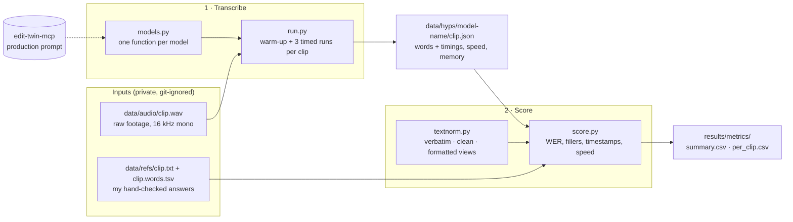

# Creator ASR Benchmark

Which speech-to-text model works best for cutting content creator videos? My editing tool (edit-twin-mcp) cuts on word timings and needs fillers (um/uh) transcribed, which public benchmarks don't measure. This benchmark tests models on my own footage.

## Models 
(currently tracking: https://huggingface.co/datasets/hf-audio/open-asr-leaderboard)
| Model | Status |
|---|---|
| Whisper large-v3-turbo (baseline, current production) | in progress |
| Parakeet TDT 0.6B v3 (NVIDIA) | to do |
| Qwen3-ASR 1.7B (Alibaba) | to do |

## Metrics and decision rule
Fixed before running anything: see [docs/metrics.md](docs/metrics.md).

## Dataset
| | |
|---|---|
| Clips | 5 (2 reels, 3 vlog clips; 1 voiceover) |
| Audio | ~11 min, 16 kHz mono, raw uncut footage |
| Reference words | 1,197 |
| Fillers (um/uh/hmm) | 20 |
| Speakers | 1 (me) |
| Word timings | to do (Audacity, 2–3 clips) |
| Silence clips | to do (room tone, music) |

Clips and transcripts are my own unpublished footage and are not included in this
repo. References were transcribed verbatim by hand, starting from Whisper drafts; see
[docs/labelling-guide.md](docs/labelling-guide.md).

## How it works

1. **Transcribe:** `run.py` sends every clip through one model from `models.py` and
   saves the words, their timings and how long each run took.
2. **Score:** `score.py` compares each model's words with my references, after
   `textnorm.py` puts both into the same format, and writes one row per model.

Every model returns the same `[[word, start, end], ...]` format, so adding a model
only means adding one function to `models.py`.

## How to run
    uv run python -m src.run whisper-turbo   # transcribe all clips -> data/hyps/
    uv run python -m src.score               # -> results/metrics/summary.csv, per_clip.csv
    uv run pytest                            # fast checks on small examples
    uv run pytest -m slow                    # also run the real model on one clip

## Repo layout
    src/textnorm.py   normalise transcripts (verbatim, clean, formatted views)
    src/score.py      compute the metrics
    src/models.py     one function per model, all returning [[word, start, end], ...]
    src/run.py        transcribe every clip with one model, timing each run
    tests/            checks on small examples with known answers
    docs/             metrics, decision rule and labelling guide
    data/             audio, references and model outputs (private, git-ignored)

## Results
TBD

## Setup
- Apple M4 Pro, 24 GB RAM, macOS 15.6.1
- Python 3.13, managed with [uv](https://docs.astral.sh/uv/)
- Requires [edit-twin-mcp](https://github.com/alyssasworld/edit-twin-mcp) cloned next
  to this repo (`../edit-twin-mcp`): the Whisper baseline uses its production
  verbatim prompt.

      uv sync