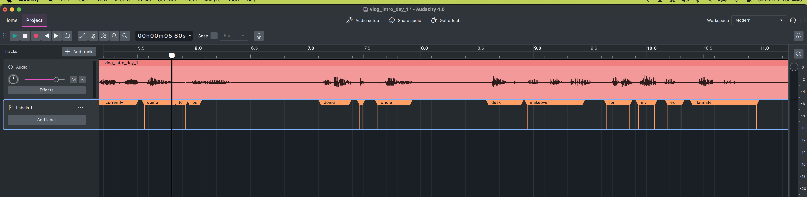
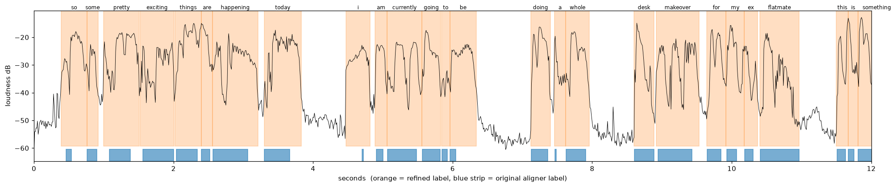

# Edit Twin ASR Benchmark

This benchmark repo aims to determine which speech-to-text model works best for cutting and captioning content creator videos. My editing tool (edit-twin-mcp) cuts on word timings and needs fillers (um/uh) transcribed, which public benchmarks don't measure. This benchmark repo tests models on my own footage.

## Models 
(currently tracking: https://huggingface.co/datasets/hf-audio/open-asr-leaderboard)
| Model | Status |
|---|---|
| Whisper large-v3-turbo (baseline, current production) | done |
| Parakeet TDT 0.6B v3 (NVIDIA) | done: **leads** (see [Results](#results)) |
| Qwen3-ASR 1.7B + Qwen3-ForcedAligner 0.6B (Alibaba) | done: out (drops fillers) |

## Metrics and decision rule
Fixed before running anything: see [docs/metrics.md](docs/metrics.md).

## Dataset
| | |
|---|---|
| Clips | 5 (2 reels, 3 vlog clips; 1 voiceover) |
| Audio | ~11 min, 16 kHz mono, raw uncut footage |
| Reference words | 1,197 |
| Fillers (um/uh/hmm) | 20 |
| Speakers | 1 (me) |
| Word timings | 706 words over 3 vlog clips (automatic: aligner + waveform fit, spot-checked by eye) |
| Silence clips | 1 (53 s room tone) |

Clips and transcripts are my own unpublished footage and are not included in this
repo. References were transcribed verbatim by hand, starting from Whisper drafts; see
[docs/labelling-guide.md](docs/labelling-guide.md).

## How it works

1. **Transcribe:** `run.py` sends every clip through one model from `models.py` and
   saves the words, their timings and how long each run took.
2. **Score:** `score.py` compares each model's words with my references, after
   `textnorm.py` puts both into the same format, and writes one row per model.

Every model returns the same `[[word, start, end], ...]` format, so adding a model
only means adding one function to `models.py`.

## Preparing the data
Done once, before any model is compared. Each step says which tool to use and what it
produces. Transcript rules and Audacity click-by-click steps:
[docs/labelling-guide.md](docs/labelling-guide.md).

**1. Audio** (tool: `ffmpeg`). Cut each clip from raw footage into a 16 kHz mono `.wav`:

    ffmpeg -i footage.MP4 -ss 00:01:00 -t 120 -vn -ac 1 -ar 16000 data/audio/<clip>.wav

**2. Reference transcript** (tool: a text editor). Since I initially started with MCP creation and tested via editing my own videos, I already had some Whisper transcripts created. So, I started from a Whisper transcript and
correct every word while listening, keeping fillers and retakes. Then saved as
`data/refs/<clip>.txt`.

**3. Word timings**, for a few clips only. Timing every word by hand takes hours, so
the timings are made automatically and spot-checked. The tools were built with Claude
Code.
- a. **Draft** (`tools/draft_timings.py`): a neutral aligner (Meta's MMS, not one of
  the models being tested) finds a start and end time for every word of the reference.
  It writes `data/refs/<clip>.words.draft.txt`:

      uv run --no-project --with torch==2.8.0 --with torchaudio==2.8.0 \
          --with whisper-normalizer python tools/draft_timings.py <clip>

- b. **Fit to the waveform** (`tools/refine_timings.py`): the aligner makes words too
  short, so each label is stretched until the sound actually starts and stops. This
  rewrites the draft (the original is kept as `.words.aligned.txt`) and saves a plot
  to `data/refs/<clip>.draft.png`:

      uv run --with matplotlib python tools/refine_timings.py <clip> --plot

- c. **Spot-check the plot by eye**: each orange label should sit on a burst of sound
  and not spill into silence. If it looks right, copy the draft to
  `data/refs/<clip>.words.txt`, the file that gets scored. (Optional, more thorough:
  import the draft into Audacity as labels and listen to each word; see the guide.)

How it went. Opening the aligner's labels in Audacity showed the problem: short words
like "to" and "be" are slivers, much shorter than the sound above them.

After fitting, the labels cover the sound (blue = aligner, orange = fitted). I
checked this plot of the first 12 s of `vlog_intro_day_1` by eye.

This changed the results: against the aligner's labels Whisper's median end error
looked like 46 ms, against the fitted labels it is 120 ms. Whisper ends words early
by about as much as the aligner did, so the unfitted labels hid the problem.

Limits: looking at a plot shows that a label sits on sound, not that it's the right
word, and inside fast connected speech there is no visible gap to fit to. No labels
were checked by ear. Every model is scored against the same labels, so comparisons
between models are fair; treat the exact millisecond values as approximate.

**4. Silence clip** (tools: a camera or mic, then `ffmpeg`). Record ~60 s of the empty
room where you film, with the same mic. Convert it, trimming off the seconds where you
touched the camera:

    ffmpeg -i roomtone.MP4 -ss 5 -to 58 -vn -ac 1 -ar 16000 data/audio/silence_roomtone.wav

**Then run the models** (next section). After new or changed audio, re-run `src.run`
for every model. After changed references or timings, re-running `src.score` is enough.

## How to run
    uv run python -m src.run whisper-turbo   # transcribe all clips -> data/hyps/
    uv run python -m src.run parakeet-tdt    # same for every model in src/models.py
    uv run python -m src.run qwen3-asr
    uv run python -m src.score               # -> results/metrics/summary.csv, per_clip.csv
    uv run pytest                            # fast checks on small examples
    uv run pytest -m slow                    # also run the real model on one clip

## Repo layout
    src/textnorm.py   normalise transcripts (verbatim, clean, formatted views)
    src/score.py      compute the metrics
    src/models.py     one function per model, all returning [[word, start, end], ...]
    src/run.py        transcribe every clip with one model, timing each run
    tools/draft_timings.py   draft word timings with a neutral aligner
    tools/refine_timings.py  fit those timings to the waveform and plot them for checking
    tests/            checks on small examples with known answers
    docs/             metrics, decision rule, labelling guide and README images
    data/             audio, references and model outputs (private, git-ignored)

## Results
Run 2026-11-02, all three models back to back on the Mac below, plugged in.
Full numbers: [results/metrics/](results/metrics/).

| | Parakeet TDT 0.6B v3 | Whisper large-v3-turbo | Qwen3-ASR 1.7B |
|---|---|---|---|
| Verbatim WER (lower is better) | **3.8%** | 6.6% | 7.9% |
| Clean WER (fillers removed) | **3.8%** | 5.9% | **3.8%** |
| Filler recall (um/uh caught) | **80%** (16 of 20) | 35% (7 of 20) | 15% (3 of 20) |
| Filler precision | 94% | 88% | **100%** (3 of 3) |
| End timestamp error, median | 100 ms | 120 ms | **49 ms** |
| Ends within 100 ms | 48% | 42% | **82%** |
| Start timestamp error, median | 100 ms | 140 ms | **38 ms** |
| Invented words on room tone | **0 / min** | 4.5 / min ("Thank you." ×2) | 1.1 / min ("Oh.") * |
| Formatted WER (case + punctuation) | 14.6% | **13.3%** | 21.8% |
| Speed (RTFx) | **95×** real time | 27× | 18× |
| Load time (first run) | **3.7 s** | 11.0 s | 16.6 s |
| Peak GPU memory | 2.7 GB | **2.6 GB** | 7.5 GB |

\* after adding a loop guard; out of the box Qwen invented 4,637 words per minute on
room tone. See [Qwen3-ASR: getting stuck on silence](#qwen3-asr-getting-stuck-on-silence).

**Decision rule:** a model must not be worse than Whisper on filler recall or end
timestamps, then the lowest verbatim WER wins.
- **Parakeet passes** both checks and has the lowest verbatim WER: **it wins.** Its one
  weakness is punctuation and capitals, which matters for vlog subtitles.
- **Qwen is out:** it catches fewer fillers than Whisper (15% vs 35%). It writes clean,
  accurate transcripts (it ties Parakeet on clean WER) but leaves out um/uh, which
  edit-twin needs. Its word timings are by far the best of the three, because they
  come from a separate aligner model.

Caveats:
- The reference word timings were also made by an aligner, which may favour Qwen's
  aligner-made timings over the other two.
- References started from Whisper drafts, which if anything favours Whisper.
- Parakeet runs in 30 s chunks. That setting was chosen after comparing options on
  these clips: 120 s chunks silently dropped 22 s of speech, and a single pass over the
  whole file was less accurate. It is tuned on the test set, so treat filler recall as
  roughly 80–90% (it varied with the chunk setting).
- Small dataset: 5 clips, ~11 min, one speaker, 20 fillers. Word timings cover 3 clips
  and were made automatically, spot-checked by eye on one plot, not by ear.
- Speed depends on the laptop's state: on battery, every model ran 30–40% slower.
  Models are always run back to back, plugged in; gaps under ~10% are a tie.

### Model setup notes
**Parakeet: how long audio is split matters.** Parakeet's first run used 120 s chunks
and scored 16% verbatim WER on `reel_navier_01`, much worse than Whisper. Listing its
errors showed ~45 words missing in one block rather than scattered mistakes, which
pointed to the code around the model, not the model. Its words had a 22 s gap
(179 s → 202 s): the library lost them when joining overlapping chunks. Comparing
settings on the two long clips (verbatim WER):

| Chunk size | `reel_navier_01` (4 min) | `vlog_intro_day_3` (6 min) |
|---|---|---|
| Whole file, one pass | 12.9% | 5.9% (and 8.4 GB GPU memory) |
| **30 s, 5 s overlap** (used) | **5.9%** | **1.7%** |
| 60 s, 15 s overlap | 9.1% | 1.9% |
| 120 s, 15 s overlap | 16.1% (22 s of speech lost) | 1.9% |

30 s was best on both clips and matches the 30 s window Whisper uses. Because it was
picked by looking at these test clips, it slightly flatters Parakeet; with only 5
clips there's no separate set to tune on. Lesson: when a model scores badly, check
how it's being run before blaming the model.

**Qwen3-ASR: getting word timings.** Qwen3-ASR only outputs text. Qwen's recommended
way to get word times is a second model, Qwen3-ForcedAligner, which places each word
of the text on the audio. Both run in [mlx-audio](https://github.com/Blaizzy/mlx-audio)
at full precision (bf16, like the other models), and both count towards Qwen's speed.
The aligner reads a whole piece in one go and is meant for up to ~5 min, so audio is
cut into pieces of up to 30 s (at quiet moments) and each piece is aligned with its
own text. The aligner drops punctuation ("today." → "today"), so its times are paired
back onto the punctuated words, which formatted WER needs.

#### Qwen3-ASR: getting stuck on silence
Step by step, from the first run to the fix:

1. **Symptom.** On the 53 s room-tone clip, Qwen wrote 4,096 words (4,637 per minute)
   and took 161 s, 3× longer than the clip itself.
2. **What it wrote.** "Oh." once, then "oh, oh, oh, ..." 4,094 times.
3. **Where.** Split into its two pieces: the first (0–29 s) gave a single "Oh." and
   stopped normally. The second (29–53 s) started "oh," and never stopped, until it hit
   the model's limit of 8,192 tokens (word pieces). That piece alone took ~190 s.
4. **Why.** Qwen3-ASR writes its transcript like a chatbot, one token at a time, each
   chosen based on what it has written so far. With no speech to anchor it, once it
   has written "oh," the most likely next token is another "oh,", so it feeds itself.
   It only stops when it chooses an end token, which it never did. Whisper has
   built-in safeguards for this (a "no speech" check and a repetition check), and
   Parakeet can't loop at all (it emits at most a few tokens per slice of audio).
5. **How big the gap is.** On my speech clips Qwen needed at most 3.9 tokens per second
   of audio (median 2.1). The loop produced ~340 per second.
6. **A fix I rejected.** Whisper's own repetition check discards text that compresses
   more than 2.4×. But my real retakes are repetitive too: "So AI just helped. So AI
   just helped. So AI just helped." scores 2.78, so that rule would have deleted real
   speech. (The loop scored 30.)
7. **The fix.** Each piece gets an allowance of 10 tokens per second of audio (2.5× the
   most my speech needed). Normal output stops by itself well within it; output that
   uses up the whole allowance never stopped, so it's a loop and is thrown away. No
   threshold to tune, and retakes can't trigger it.
8. **Checked.** Room tone: 4,637 → 1.1 invented words per minute (only the first
   "Oh." is left; it's a one-off, like Whisper's "Thank you."). Every speech metric
   came out identical to before the fix, so nothing real was thrown away. Timed side
   by side, the fix costs no speed (15.3 s vs 15.6 s on `reel_navier_01`).

What this means for edit-twin: any long pause, room tone or music in a video could
fill with invented words. Any model that writes text this way (an "LLM-style" speech
model) needs a guard like this before it goes near production.

## Setup
- Apple M4 Pro, 24 GB RAM, macOS 15.6.1
- Python 3.13, managed with [uv](https://docs.astral.sh/uv/)
- Requires [edit-twin-mcp](https://github.com/alyssasworld/edit-twin-mcp) cloned next
  to this repo (`../edit-twin-mcp`): the Whisper baseline uses its production
  verbatim prompt.
- For preparing data: `ffmpeg` and Audacity (`brew install ffmpeg`,
  `brew install --cask audacity`)

      uv sync